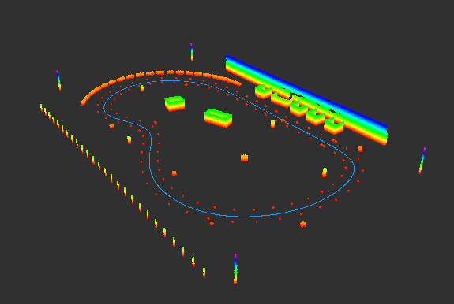
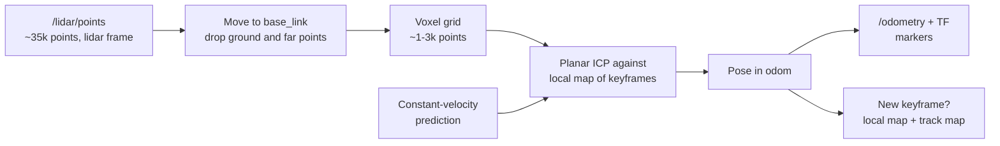
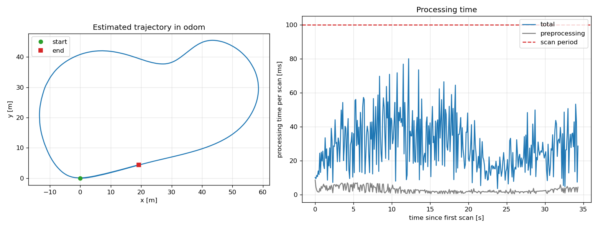

# Report — LiDAR odometry (path B)

This report explains how the odometry works, the problems I met and how I solved them, what the
measurements say and what I would improve. How to run it is in the [README](README.md).

## 1. Result in short

| | Value |
|---|---|
| Scans processed | 344 of 344, one `/odometry` message each |
| Processing time per scan | mean 30.5 ms, 95th percentile 60 ms, worst 96 ms |
| Scans over the 100 ms budget | 0 |
| End of the lap vs. first pass over the same stretch | 0.08 m and 0.28° difference |

*Track map built from the keyframes and their estimated poses. The cones (red dots) form two
clean lines on both sides of the trajectory, also where the lap overlaps its own start: a drifting
estimate would show them doubled there.*

## 2. Approach

**Preprocessing.** Each scan is moved from the `lidar` frame to `base_link` with the transform
read once from `/tf_static`. The sensor is pitched by 3°, so this is needed before any height
threshold: in `base_link` the flat ground lies at z = 0 and can be removed with a single
comparison. Points beyond 40 m are dropped as well. Both checks happen in one pass over the
points; a voxel grid then keeps one point per cube, so the cost of registration no longer depends
on how dense the scan is close to the sensor.

**Registration.** I align each scan with ICP, but with two choices that make it both more accurate
and faster:

- *Planar motion.* The ground is flat and nothing moves except the car, so only x, y and yaw are
  estimated (PCL's `TransformationEstimation2D`). With the ground removed, z, roll and pitch would
  be poorly constrained; estimating them could only add drift.
- *Scan-to-map, not scan-to-scan.* Each scan is aligned against a local map made of the last 10
  keyframes, i.e. about 20 m of track. Chaining scan-to-scan alignments adds every small error to
  the next one; a map built from several scans is denser and more stable. A scan becomes a
  keyframe after 2 m of travel or 10° of rotation, so the map, and ICP's search tree, are rebuilt
  only every few scans.

ICP starts from a *constant-velocity prediction*: the car is assumed to repeat the motion of the
previous interval. ICP converges reliably only from a guess close to the solution, and at 10 Hz the
motion changes little from one interval to the next. If ICP does not converge, the prediction is kept and the scan
is not added to the map, so one bad scan cannot corrupt the next ones (this never happened on the
recording).

**Outputs.** The pose is published on `/odometry` and as the `odom → base_link` transform. I used standard messages wherever one exists, so other ROS nodes and
RViz can read them directly; the only message of my own is `ProcessingTime`, since no standard
message carries per-stage timing.

**Structure.** The ROS node only moves data in and out. The algorithm itself lives in modules that do not depend on ROS (preprocessing, local_map, scan_to_map_odometry, track_map); visualization and parameters help the node with markers and parameters.

| Module | Responsibility |
|---|---|
| `preprocessing` | move to the vehicle frame, remove ground and far points, voxel grid, cloud transforms |
| `local_map` | sliding window of keyframes merged into one cloud in `odom` |
| `scan_to_map_odometry` | prediction, planar ICP, pose, keyframe decision |
| `track_map` | map of the whole track (nice to have) |
| `visualization` | trajectory and vehicle markers |
| `parameters` | declaration, valid ranges and reading of every parameter |
| `lidar_odometry_node` | subscriptions, TF, publishing, timing |

## 3. Results

### Accuracy

The car starts at the origin, drives the lap, passes the origin again and keeps going for about 19 m
while braking. If the odometry did not drift, the end of the run must lie exactly on the first
part of the trajectory, which was estimated more than 300 scans earlier. With the current
parameters the last pose is **0.08 m** from the first pass and differs by **0.28°** in heading,
after about 195 m: a drift of roughly 0.04%. The track map confirms it visually (figure above).

At first I thought the final pose (19.5, 4.5) was too far from the origin. It is not an error:
the origin of `odom` is where the car stood still, not the start line, and the car only comes to a
stop well after crossing it. What matters is that the second pass overlaps the first.

### Processing time

All numbers come from `scripts/evaluate_run.py` on runs recorded with RViz closed, on a laptop
running Windows 10, WSL2 and Docker.

| Configuration | Scans | Mean | p95 | Worst | > 100 ms | Lap closure |
|---|---|---|---|---|---|---|
| First complete run | 289/344 | 96 ms | 286 ms | 557 ms | 82 | 0.27 m, 0.2° |
| Local map and ICP tuned | 344/344 | 41 ms | 87 ms | 225 ms | 7 | 0.15 m, 0.15° |
| Same, three repeated runs | 344/344 | 43–45 ms | 86–90 ms | 123–134 ms | 3–11 | 0.15 m, 0.15° (identical) |
| Max range 25 m (rejected) | 344/344 | 35 ms | 70 ms | 97 ms | 0 | 0.29 m, 1.25° |
| Scan voxel 0.3 m | 344/344 | 32.5 ms | 61 ms | 90 ms | 0 | 0.08 m, 0.28° |
| **Unused fitness removed (final)** | **344/344** | **30.5 ms** | **60 ms** | **96 ms** | **0** | **0.08 m, 0.28° (identical)** |

The final row only removes an unused fitness score that ICP computed after every alignment, one more nearest-neighbour search per scan: same trajectory, mean registration time from 29.9 to 27.0 m

Preprocessing takes 1–3 ms; almost all of the time is ICP. The last two rows give the same
trajectory; the worst scan differs by a few milliseconds from run to run, as section 4.6 explains.

## 4. Problems and how I solved them

### 4.1 RViz rejected the odometry: unnormalized quaternion

After a while RViz refused the `/odometry` messages. ICP works in `float`, and composing its
results scan after scan slowly broke the orthogonality of the rotation matrix, until the
quaternion derived from it no longer had unit norm. Since only x, y and yaw are estimated, I now
rebuild the pose from these three values after every alignment. The rotation is exact again, and
z, roll and pitch stay exactly zero.

### 4.2 Too slow: dropped scans

The first complete run took 96 ms per scan on average and up to 557 ms; 55 scans were dropped
because the node was still busy.
With a keyframe every metre and the car moving about 0.65 m per scan, the local map and ICP's
search tree were rebuilt almost every other scan, and ICP ran up to 30 iterations with a 1 mm stop
criterion. Spacing keyframes 2 m apart, halving the window to 10 keyframes (still about 20 m of
track), using a 0.3 m voxel for the map, a 1 cm stop criterion and at most 20 iterations brought
the mean to 41 ms with no dropped scans. The lap also closed better, 0.15 m instead of 0.27 m,
because the constant-velocity prediction no longer had to bridge missing scans.

### 4.3 A wrong hypothesis: "only the cones matter"

Since the track is defined by cones, I expected far points to be useless and tried a 25 m range
instead of 40 m. It was faster (35 ms mean, no scan over budget), but the heading error at the
end of the lap grew from 0.15° to 1.25° because far points are the ones that constrain rotation best. In one stretch only 170–330 points were
left so ICP couldn't work properly. I kept 40 m and had to find other solutions.

### 4.4 Peaks over 100 ms: algorithm or machine?

With the tuned parameters a few scans still took more than 100 ms. I ran the same configuration
three times: the trajectories were identical to the last digit, since the computation is
deterministic, but the slow scans were 11, 6 and 3, at different times. So the peaks came from
the host (Windows, WSL and Docker competing for the CPU), not from the algorithm. Still, a 95th
percentile around 87 ms left little margin. ICP's cost grows with the number of scan points, so, considering the size of the cones, I
tried a 0.3 m voxel for the scans instead of 0.2 m: the mean dropped to 32.5 ms, the worst scan to
90 ms, and the lap closure stayed within a few centimetres and a tenth of a degree.

### 4.5 Clock issues

At first I used --clock and use_sim_time, which I had found to be common practice when replaying bags. While developing I realised it was not needed, since every output is stamped with the time of its scan, so I removed it for simplicity: one less option to remember, and to get wrong, when playing the bag. The trajectory stayed identical.

### 4.6 Sliding window or the whole map?

Since the node already builds a map of the whole track, I wondered whether aligning against it would be better than a window of the last 10 keyframes. It would also make the code simpler, with one module and two parameters less. I tested it by raising local_map.max_keyframes to 100: the lap produces 102 keyframes, and only the first two, taken while the car was still almost standing at the start, would be dropped, so the window covers practically the whole track.

On one lap the cost barely changed: 31.9 ms mean against 30.5 ms, no scan over budget. The end of the lap matched the first pass better in heading (0.03° against 0.28°) but not in position (0.14 m against 0.08 m). This does not mean the estimate improved. Near the end the scans were also aligned to cones mapped at the start, so the lap closure was no longer an independent measure of drift, and ICP had to reconcile two slightly different copies of the same cones. Over several laps it would get worse: the voxel grid keeps the map size bounded on a closed track, but the drift would add slightly shifted copies of the same cones, and ICP would be aligning against a blurred map.

I kept the window: it only contains recent, consistent scans, and it keeps the lap closure an honest measure of the result.

## 5. What could be improved

- **Loop closure.** The lap closes within 0.08 m on its own, but nothing corrects drift on longer
  runs. Recognising the start area and adding a pose-graph optimisation would.
- **Velocity and covariance.** `/odometry` carries only the pose; twist and covariances are zero.
  The velocity could be easily derived from the motion between scans, and ICP's residuals could give a
  rough covariance.
- **Rebuild the map off the critical path.** The local map and its search tree are rebuilt inside
  the scan callback when a keyframe is added. Doing it in a second thread would take this work out of the scan callback, so scans that create a keyframe would not take longer than the others.
- **Restart on time jumps.** The node could detect a scan older than the previous one, as when the
  bag is replayed, and reset itself instead of requiring a restart.

## 6. Use of AI

How I used AI tools, and for what, is described in [AI_USAGE.md](AI_USAGE.md).
